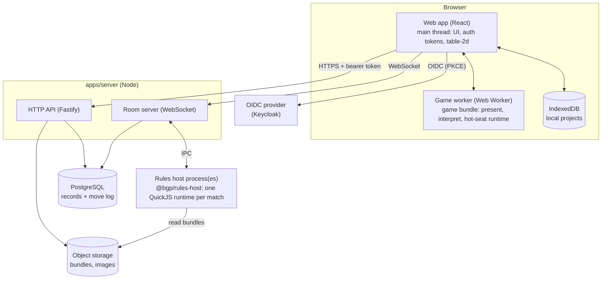
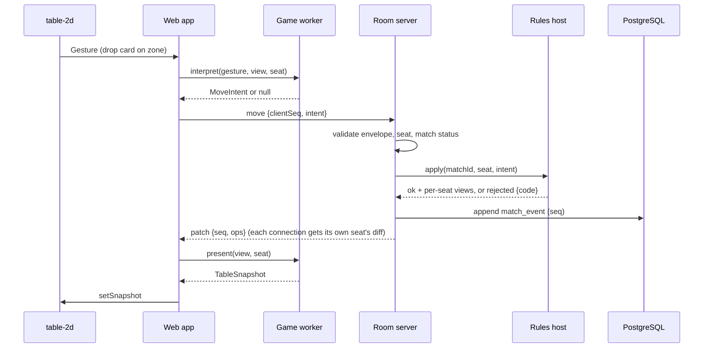

# Architecture

Phase 1 is a single web app, one Node server process (HTTP API plus WebSocket room server), and a separate rules-host process that runs untrusted game code. Game code also runs in the browser, but only inside a Web Worker. PostgreSQL holds records and the move log; object storage holds game bundles and images.

## System context



## Runtime components

| Component                          | Runs where                                                      | Responsibility                                                                                                                                                                                                                                                                                                               |
| ---------------------------------- | --------------------------------------------------------------- | ---------------------------------------------------------------------------------------------------------------------------------------------------------------------------------------------------------------------------------------------------------------------------------------------------------------------------- |
| Web app (`apps/web`)               | Browser main thread                                             | Routing, sign-in, project editor, lobby, table UI, hand overlay, replay viewer. Holds auth tokens. Never evaluates game code.                                                                                                                                                                                                |
| Game worker                        | Browser Web Worker                                              | Loads a game bundle. Runs `present` and `interpret` for remote matches, and the full rules runtime for hot-seat play. Network and storage globals are removed before game code loads.                                                                                                                                        |
| HTTP API (`apps/server`)           | Node                                                            | Accounts, games and versions, asset upload, matches, invites, replays.                                                                                                                                                                                                                                                       |
| Room server (`apps/server`)        | Node, same process as API in Phase 1                            | WebSocket connections, seat checks, ordering of moves, persistence of events, per-seat view diffs, presence. Never evaluates game code itself.                                                                                                                                                                               |
| Rules host (`packages/rules-host`) | Separate Node process, spawned by the server                    | Runs each live match in its own sandbox (Phase 1 default: a QuickJS runtime holding the `@bgp/rules` runtime plus the game bundle, D-008). Applies moves under time and memory limits, returns per-seat views, exports snapshots. The sandbox sits behind a `RulesSandbox` interface so D-008's alternatives can replace it. |
| PostgreSQL                         | Service                                                         | Users, games, versions, matches, seats, the append-only move log, snapshots.                                                                                                                                                                                                                                                 |
| Object storage                     | Service (filesystem driver in dev, S3-compatible in production) | Game bundles, component images, generated card faces.                                                                                                                                                                                                                                                                        |
| OIDC provider                      | Service (Keycloak)                                              | Designer accounts. Playtesters join as guests without accounts.                                                                                                                                                                                                                                                              |

## Repo layout

```
apps/
  web/                 React + Vite single-page app
  server/              Fastify HTTP API + WebSocket room server
packages/
  schema/              @bgp/schema — Zod schemas and types for every contract
  rules/               @bgp/rules — rules runtime, seeded RNG, sandbox game, state hashing
  testing/             @bgp/testing — headless match runner, random bot, determinism and replay checks
  rules-host/          @bgp/rules-host — server-side sandbox for game bundles
  table-2d/            @bgp/table-2d — PixiJS renderer implementing TableRenderer
  card-generator/      @bgp/card-generator — template + CSV rows → card face images (Canvas 2D)
  cli/                 @bgp/cli — `bgp init | dev | validate | build | publish`
games/
  harbor-market/       Reference game (docs/reference-game.md)
infra/
  docker-compose.yml   PostgreSQL, Keycloak
  postgres/init/       Creates the test database
  keycloak/            Realm export for local development
e2e/                   Playwright end-to-end tests
scripts/               CI checks (WASM inventory scan), performance scripts
wasm-inventory.json    Every approved WASM module and its reason (D-002)
docs/                  These documents
```

## Package boundaries

Imports flow downward only. Enforce with Biome's restricted-import rules or a small CI script (task T01).

| Package               | May import                                                                                                       | Must not import                                                    |
| --------------------- | ---------------------------------------------------------------------------------------------------------------- | ------------------------------------------------------------------ |
| `@bgp/schema`         | `zod`                                                                                                            | Anything else in the repo                                          |
| `@bgp/rules`          | `@bgp/schema` (types and validators)                                                                             | DOM, Node APIs, renderers, any game                                |
| `@bgp/testing`        | `@bgp/rules`, `@bgp/schema`                                                                                      | DOM, renderers                                                     |
| `@bgp/rules-host`     | `@bgp/rules` (as a prebuilt bundle loaded into the sandbox), `@bgp/schema`, `quickjs-emscripten`, Node built-ins | DOM, renderers, database code                                      |
| `@bgp/table-2d`       | `@bgp/schema`, `pixi.js`                                                                                         | `@bgp/rules`, any game                                             |
| `@bgp/card-generator` | `@bgp/schema`                                                                                                    | `@bgp/rules`, any game                                             |
| `@bgp/cli`            | `@bgp/rules`, `@bgp/schema`, `@bgp/testing`, `esbuild`, Node built-ins                                           | Renderers                                                          |
| `games/*`             | `@bgp/rules` (SDK helpers and types), `@bgp/schema` types                                                        | Everything else; the build fails on any other import               |
| `apps/web`            | `@bgp/schema`, `@bgp/rules` (inside the game worker only), `@bgp/table-2d`, `@bgp/card-generator`                | Any game package directly (games load as bundles)                  |
| `apps/server`         | `@bgp/schema`, `@bgp/rules-host`                                                                                 | `@bgp/rules` evaluation of game code in its own process, renderers |

## Game bundles

A game package is built by `bgp build` (esbuild) into **one ES module with no imports**, `game.js`, whose default export is a `GameDefinition` ([contracts/rules-api.md](contracts/rules-api.md)). Everything the game needs, including SDK helpers, is bundled in. The bundle plus its manifest, component declarations and images form a **game version**, addressed by the SHA-256 of its contents (the build hash). Versions are immutable; a match is pinned to one build hash for its whole life.

The same `game.js` runs in two places:

- **Server, rules host:** authoritative `setup`, moves, `endIf`, `playerView`.
- **Browser, game worker:** `present` and `interpret` on the seat's view; and for hot-seat play, the full runtime.

## How a move flows (remote enforced match)



Rules that matter here:

1. The event is **persisted before** any patch is broadcast.
2. The room server keeps, per connection, the last view it sent, and diffs the new view against it (RFC 6902 JSON Patch). A client that detects a sequence gap asks for a full snapshot.
3. Phase 1 has **no client-side prediction** for enforced games. A client holds only its own view, so it cannot run moves that depend on hidden state. Dragging is shown locally as UI; the state changes when the server answers. Typical round trips on a local network are small enough for turn-based play.

## Match lifecycle

`lobby → active → finished`, or `abandoned` from `lobby` or `active`.

- **Lobby:** the creator configures seats and options; invitees claim seats through invite links.
- **Active:** starts when the creator presses start and at least `players.min` seats are filled. The rules host runs `setup` with the match seed.
- **Finished:** `endIf` returned a result. The match stays replayable.
- **Recovery:** if a rules host process dies, the server restarts it and rebuilds each live match from its latest snapshot plus subsequent events. Determinism makes this exact. Clients see a short pause, then a fresh snapshot.

## Local-first projects and hot-seat play

A **project** is a designer's editable workspace, stored in IndexedDB: draft manifest, component declarations, zones, card templates, CSV data and images. It works offline and needs no account.

- **Hot-seat play:** the game worker runs the full runtime locally. The designer can view any seat or the "all seats" debug view.
- **Publishing** (requires sign-in) builds the project into a game version and uploads it. Only published versions can host remote matches.

Code-based games follow the same path through the CLI: `bgp dev` serves the game to a local hot-seat table with hot reload; `bgp publish` uploads a version.

## Sandbox mode

Sandbox games have no game code. The built-in sandbox definition in `@bgp/rules` runs them from component and zone declarations, accepting **manual operations** (move, flip, rotate, shuffle, deal, roll). Visibility still holds: items in another seat's private zone are sent face-down without their identity. See [contracts/components-and-table.md](contracts/components-and-table.md#sandbox-state-and-manual-operations).

## Where later phases plug in

| Phase | Addition                                                                                    | Seam prepared in Phase 1                                                                                                              |
| ----- | ------------------------------------------------------------------------------------------- | ------------------------------------------------------------------------------------------------------------------------------------- |
| 2     | `@bgp/table-3d` (Three.js `WebGPURenderer`, WebGL2 fallback)                                | `TableRenderer` interface and `TableSnapshot` contract; component declarations already carry real-world sizes and material references |
| 2     | Physics behind a `PhysicsAdapter` (default Rapier; cannon-es and Jolt evaluated in a spike) | Physics stays out of rules state; cosmetic rolls animate to a server-decided result                                                   |
| 2     | GPU-compressed textures (KTX2) and Meshopt-compressed models, loaded lazily                 | Asset references are paths, so the pipeline can add compressed variants without changing contracts                                    |
| 2     | Asset pipeline and shared library                                                           | Content-addressed storage keys and asset records                                                                                      |
| 3     | Partial rules, bots, simulation, balance reports                                            | `legalMoves`, the headless runner in `@bgp/testing`, the move log                                                                     |
| 3     | Board heatmaps                                                                              | Item positions in millimeters in every snapshot                                                                                       |
| 4     | Public listing                                                                              | Game visibility field; hardened isolation is a prerequisite (D-008)                                                                   |
