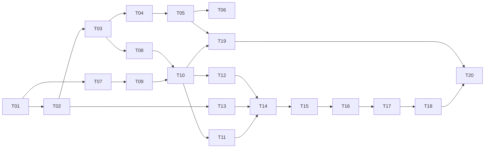

# Phase 1 tasks

Ordered, issue-sized tasks. Do them in order unless dependencies allow parallel work. Every task also has to meet the definition of done in [AGENTS.md](../AGENTS.md#definition-of-done-every-task).

## Milestones

| Milestone                       | Tasks             | Proves                                                                                             |
| ------------------------------- | ----------------- | -------------------------------------------------------------------------------------------------- |
| M1 Headless core                | T01–T06           | The runtime, sandbox mode and the reference game work, deterministically, without any UI or server |
| M2 Remote play                  | T07–T11, T13, T14 | Real matches over the network with hidden information intact                                       |
| M3 Designer tools               | T12, T15–T18      | Designers can build, publish, invite and review                                                    |
| M4 Developer path and hardening | T19, T20          | The CLI flow and every acceptance criterion                                                        |

---

### T01 Scaffold the monorepo

**Status:** Complete. Local validation and scope: [t01-validation.md](t01-validation.md).

**Deliverables:** pnpm workspace with the layout in [architecture.md](architecture.md#repo-layout) (empty packages with `package.json`, `src/index.ts`, a passing placeholder test); shared `tsconfig` base (strict); Biome config including restricted-import rules for [package boundaries](architecture.md#package-boundaries); Turborepo pipeline; every root script listed in AGENTS.md; `.nvmrc`; `.env.example` files; GitHub Actions workflow per [testing.md](testing.md#ci-pipeline); `wasm-inventory.json` (empty until T08) and the CI-WASM-INVENTORY script; the Version column of tech-stack.md filled in. Before starting: confirm the Default choices due "before T07" and "before T12" in [decisions.md](decisions.md#decision-points-by-stage) with a human, or proceed with the defaults.

**Done when:** `pnpm install && pnpm lint && pnpm typecheck && pnpm test` pass on a clean checkout; a deliberate boundary violation (for example, `@bgp/rules` importing `pixi.js`) fails lint; CI-WASM-INVENTORY fails when an unlisted `.wasm` file is planted in a build output.

### T02 `@bgp/schema`: contracts as code

**Status:** Complete. Local validation and scope: [t02-validation.md](t02-validation.md).

**Deliverables:** Zod schemas and inferred types for every contract in [contracts/](contracts/): rules API types, components file, zones, `TableSnapshot`, gestures, manual operations, manifest, protocol messages, HTTP bodies, error codes. A `json-schema` script that writes JSON Schema files to `packages/schema/json/`.

**Done when:** every example in the contract docs parses; each documented violation (bad slug, float in state, unknown message type, SVG asset, `def` on a hidden item where testable) is rejected; JSON Schema generation runs in CI.

### T03 `@bgp/rules`: runtime core

**Status:** Complete. Local validation and scope: [t03-validation.md](t03-validation.md).

**Deliverables:** sfc32 PRNG with integer-only operations; `Random` (int, die, pick, shuffle, id); canonical JSON and `hashState` (works in Node and browsers); `createMatch`, `applyIntent` following the documented [order of operations](contracts/rules-api.md#order-of-operations-in-applyintent), `viewFor`, `replay`; turns, phases and events; integer-only state check; SDK helpers (`invalid`, `defineGame`, `rekey`, `countHidden`, `seatsAfter`). A tiny tic-tac-toe test game inside the package's tests.

**Done when:** unit tests cover every rejection code and every event combination; tic-tac-toe plays to win and draw; the same seed and intents give identical hashes in repeated runs; no DOM or Node API is imported (lint).

### T04 Sandbox mode

**Deliverables:** `createSandboxDefinition(components)` with `SandboxSetup`, `SandboxState`, all `ManualOp`s, visibility rules and re-keying on shuffle, as in [components-and-table.md](contracts/components-and-table.md#sandbox-state-and-manual-operations); its `present` producing a `TableSnapshot` from declarations.

**Done when:** each operation has tests, including rejection cases; dealing into `owner` zones hides identities from other seats; after a shuffle no pre-shuffle ID of a hidden item appears in any view.

### T05 `@bgp/testing`

**Deliverables:** headless match runner; `randomBot`; determinism checker (replay and compare hashes at every step); leak checker (UNIT-LEAK logic, reusable for any game); golden replay harness and file format ([testing.md](testing.md#golden-replays)).

**Done when:** PROP-DET and UNIT-LEAK run against tic-tac-toe and a sample sandbox game; a deliberately leaky test game is caught by the leak checker.

### T06 Reference game: Harbor Market

**Deliverables:** `games/harbor-market` implementing [reference-game.md](reference-game.md) fully: rules, `playerView`, `legalMoves`, `present`, `interpret`, `actions`; `bgp.json`; `components.json` (art paths may point to files produced in T16; the renderer shows placeholders until then).

**Done when:** every test in the reference game's "Required tests" table passes, including 1,000 random games for determinism and 200 for hidden information.

### T07 Database and local services

**Deliverables:** `infra/docker-compose.yml`, PostgreSQL init script creating `bgp_test`, Keycloak realm export, Drizzle schema for every table in [data-model.md](data-model.md), first migration, `db:generate` and `db:migrate` scripts.

**Done when:** a clean `docker compose up` plus `pnpm db:migrate` creates the schema; the test database is migrated automatically by integration tests; Keycloak test users can sign in at its account page.

### T08 `@bgp/rules-host`: isolation for game code

**Starts with a spike (2–3 days):** implement a minimal `RulesSandbox` with QuickJS (quickjs-emscripten) and with the Node `vm` + process alternative; run Harbor Market and the INT-ISOLATION suite on both; measure against the spike criteria in [D-008](decisions.md#d-008-server-side-isolation-of-game-code); write `docs/spikes/t08-sandbox.md`; get the choice confirmed.

**Deliverables:** a host process started with the permission flags in D-008; the `RulesSandbox` interface with the chosen implementation (one sandbox per match, holding the `@bgp/rules` runtime bundle plus the game bundle, with memory and time limits); an IPC API: `load(buildHash)`, `create(matchId, init)`, `apply(matchId, seat, intent)`, `views(matchId)`, `hash(matchId)`, `exportState(matchId)`, `restore(matchId, snapshot, events)`, `dispose(matchId)`; a client library the server uses, which restarts crashed hosts; the QuickJS module recorded in `wasm-inventory.json`.

**Done when:** INT-ISOLATION passes; a crashed or over-limit sandbox affects only its match; calls return within the timeout plus 500 ms in all hostile cases; the spike write-up is merged.

### T09 Authentication

**Deliverables:** Fastify auth plugin verifying OIDC access tokens (issuer, audience, signature via JWKS, expiry) and upserting `users`; guest token issue and verification ([http-api.md](contracts/http-api.md#authentication)); request context with the caller's identity.

**Done when:** tests cover valid user token, expired, wrong audience, wrong issuer, tampered signature, valid guest token for the right match, guest token used on another match (`FORBIDDEN`).

### T10 HTTP API

**Deliverables:** every endpoint in [http-api.md](contracts/http-api.md); `BlobStore` with `fs` and `s3` drivers; the upload flow and finalize validation in [manifest.md](contracts/manifest.md#upload-flow), including the rules-host `setup` check; match creation with seeds and invite tokens; replay endpoint.

**Done when:** INT-UPLOAD passes; each endpoint has success and permission tests; invite tokens are stored hashed; the seed is absent from every response before a match finishes.

### T11 Room server

**Deliverables:** WebSocket endpoint and every message in [protocol.md](contracts/protocol.md); one serial queue per match; persistence before broadcast; per-connection view tracking and JSON Patch diffs; snapshots at seq 0, every 50 events and at the end; presence, chat, ephemeral relay; rate limits; recovery after rules-host restarts.

**Done when:** INT-LEAK, INT-REPLAY and INT-RECOVERY pass; every protocol error code is produced by a test; a client that drops a patch gets a snapshot after `resync`.

### T12 Web app shell

**Deliverables:** React + Vite app; routes for home, projects, games, matches, invite claim (`/join/:token`), lobby, match, replay; OIDC sign-in with oidc-client-ts, tokens kept in memory; typed API client using `@bgp/schema`; TanStack Query; basic layout and empty states.

**Done when:** a Playwright test signs in as `designer1`, sees an empty games list, and a guest claims an invite and reaches the lobby.

### T13 `@bgp/table-2d`

**Starts with a spike (2 days):** render the same fixture snapshot with PixiJS, a top-down orthographic Three.js view, and plain Canvas 2D; measure against the T13 criteria in [decisions.md](decisions.md#decision-points-by-stage); write `docs/spikes/t13-renderer-2d.md`; get the choice confirmed. The deliverables below assume PixiJS, the default.

**Deliverables:** a PixiJS v8 implementation of `TableRenderer`: all zone layouts, item drawing (images, card backs, labeled placeholders when art is missing, die faces, badges, highlights), drag and drop with drop-zone feedback, selection, animated transitions matched by item ID, view rotation for the viewing seat, pinch and pan on touch, a dev page `/dev/table` that renders fixture snapshots.

**Done when:** layout math has unit tests; fixture snapshots render correctly at 360 px and 1,440 px widths in Chromium, Firefox and WebKit (Playwright screenshots reviewed once, then used as regression baselines); gestures emit the documented `Gesture` shapes.

### T14 Game worker and match page

**Deliverables:** the game worker (removes globals per D-007 before evaluating the bundle; exposes `present`, `interpret`, `actions` and a hot-seat runtime over `postMessage`); the WebSocket client (hello, patches, resync, reconnect with backoff); the match page wiring view → `present` → table, gestures and action buttons → `move`, plus HUD, prompt, chat, `rejected` messages and the result screen.

**Done when:** E2E-04 and E2E-05 pass using a Harbor Market version uploaded by a test fixture script; the worker's `fetch` and `indexedDB` are unavailable to game code (unit test in the browser).

### T15 Local-first projects and hot-seat play

**Deliverables:** IndexedDB stores per [data-model.md](data-model.md#browser-indexeddb-bgp-database); project list; component editor (all Phase 1 kinds); zone editor on the table (draw and resize zones, set layout, owner, visibility); setup editor; image import; hot-seat play in the game worker with a seat switcher and an "all seats" debug view.

**Done when:** E2E-01 passes except card generation; projects survive a browser restart; everything works with the network disabled.

### T16 Card generator

**Deliverables:** `@bgp/card-generator` (template of text and image fields positioned in mm, rendered at 300 dpi to PNG with `OffscreenCanvas`); template editor UI with live preview; CSV import with column-to-field mapping (Papa Parse); generated faces added to the project's assets and component defs; Harbor Market art generated with it and committed.

**Done when:** E2E-01 passes in full; generating 100 cards takes under 10 seconds on a mid-range laptop.

### T17 Publish, create match, invite

**Deliverables:** publish from a project (build `bgp.json` and `components.json`, upload files, finalize, show validation errors); game and version pages; create match (seat count, options); invite links with copy buttons; lobby with seat status and start button.

**Done when:** E2E-02 and E2E-03 pass.

### T18 Replay viewer

**Deliverables:** replay page that downloads the replay, rebuilds states in the game worker, and steps forward and back through events with the table, choosing the seat perspective or the all-seats view; shows the final hash check.

**Done when:** INT-REPLAY and E2E-06 pass; stepping through a 300-event match stays responsive.

### T19 CLI

**Deliverables:** `@bgp/cli` with `bgp init` (scaffold a game package from a template), `bgp dev` (esbuild watch, serves a hot-seat table using the web app's hot-seat page, reloads on change while keeping events and replaying them), `bgp validate` (schemas, bundle shape, no imports, determinism and leak checks with the random bot), `bgp build`, `bgp publish` (device-code or browser sign-in, then the upload flow).

**Done when:** E2E-07 passes; `bgp validate` catches a planted leak and a planted `Math.random`.

### T20 Hardening and handoff check

**Deliverables:** PERF-01 script and results; full browser matrix run; keyboard operation of selection and the action bar; error and empty states reviewed; README and dev-environment.md verified on a clean machine; the acceptance criteria table in [phase-1-spec.md](phase-1-spec.md#acceptance-criteria) checked off with links to passing runs.

**Done when:** every acceptance criterion AC-01 to AC-15 passes.
